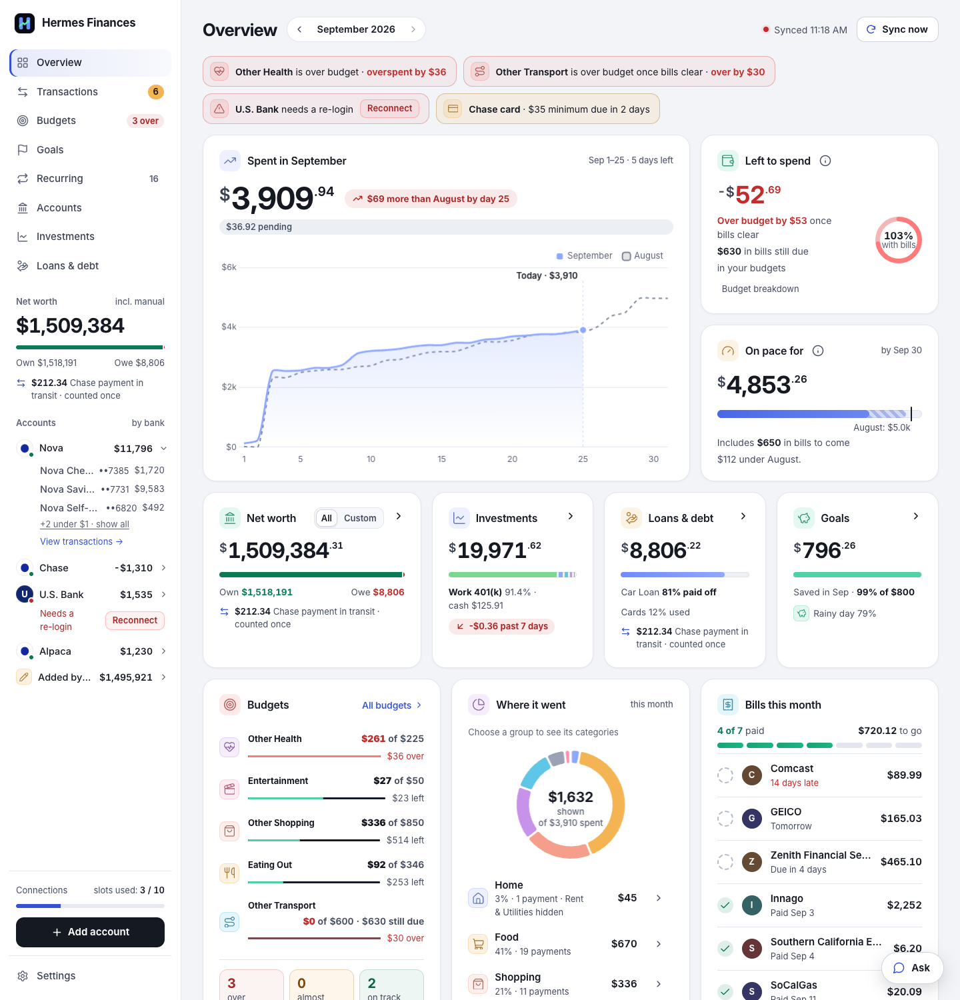

# hermes-finance

A self-hosted personal-finance dashboard for people who already run [Hermes](#the-three-ai-modes). It pulls your
accounts, balances and transactions from Plaid into a SQLite file on your own computer. It files spending into
categories and tracks budgets, recurring bills, goals, loans, investments and net worth. For what Plaid can't see (a
car, a home, a loan from a lender that isn't connected) you add an account by hand or import a CSV, OFX or QFX file.
Your agent gets the same numbers as native tools, over MCP, or through the dashboard's own Ask panel.

Full documentation: [`docs/`](docs/index.md), a MkDocs site (`uvx --python 3.12 --with "mkdocs-material>=9.5,<10" --from "mkdocs>=1.6,<2" mkdocs build --strict`).

Try the [read-only static demo](docs/demo.md) with synthetic data; it builds without an account or API key.

<picture>
  <source media="(prefers-color-scheme: dark)" srcset="docs/assets/screenshots/overview-dark.png">
  
</picture>

## Quickstart

You need Python 3.12 and [uv](https://docs.astral.sh/uv/).

### Look around without any account

A synthetic database and a throwaway credentials file (nothing is sent to Plaid unless you click Continue to Plaid):

```sh
git clone https://github.com/<owner>/hermes-finance.git   # <owner>: wherever you found this repository
cd hermes-finance
uv sync                                           # .venv on Python 3.12
T=$(mktemp -d); mkdir "$T/data"
printf 'PLAID_CLIENT_ID=fake0000000000000000001\nPLAID_SECRET=fake000000000000000000000000\n' > "$T/env"
uv run python tests/demo_data.py "$T/data"       # add a number (e.g. 30) for that many days of holding snapshots
HERMES_ENV_FILE="$T/env" FINANCE_DATA_DIR="$T/data" uv run finance serve --port 8799
```

Open <http://127.0.0.1:8799/>.

### Plaid Sandbox in five minutes

You need a Plaid account's **client ID** and **Sandbox secret**.

```sh
uv run finance serve      # http://127.0.0.1:8765/
```

Open <http://127.0.0.1:8765/>. The first-run wizard opens: setup happens in the browser.

1. Paste the client ID and the Sandbox secret. They're saved to `~/.config/hermes-finance/secrets.env` (0600). For
   AI, pick *No AI for now* to just look around.
2. *Who can open this app?* Keep **This computer only**.
3. Pick **Try demo** (Plaid Sandbox, fake data).
4. **Connect a bank**: Plaid Link opens. Pick any bank and sign in as `user_good`, password `pass_good`. The app
   stores the connection and runs the first sync.

Then, from another terminal in the checkout:

```sh
uv run finance status                # banks, accounts, balances, slots used
uv run finance doctor                # every integration and what it is missing
uv run finance sync                  # pull what's new
uv run finance spend --by category   # this month's spending, compared with last month
uv run finance bills --next 14d      # recurring bills coming up
```

`finance networth [--history] [--custom] [--json]` prints net worth grouped as on the Accounts page. Its
**All · Custom** switch, and `finance networth-custom`, choose which accounts *Custom* counts. That's one saved setting
(`networth_excluded`), so the page and the CLI always agree.

Every command is in the [CLI reference](docs/reference/cli.md), generated from `finance --help`; the
[user guide](docs/guide.md) covers each one in detail. More: [Getting started](docs/getting-started.md) and
[Plaid setup](docs/plaid.md).

> **The 10-connection rule.** A Plaid Trial account allows at most 10 Items (bank logins) for the life of the account,
> and removing one does not give the slot back. The app counts every connection ever made (`slots used: N / 10`),
> refuses to connect the same bank twice, and offers **Reconnect** (Link's update mode, no new Item) for a broken
> one. Never connect a bank a second time. Details: [Plaid setup](docs/plaid.md).

## Install as a Hermes plugin

Version 0.2.0 is a beta. No bank or API key is required to install the plugin or read
a local database. Plaid, market data and AI providers are optional; manual accounts,
imports and synthetic data work without them.

The plugin is an adapter, so first prepare a trusted **app checkout** with Python 3.12
and uv. Do not install the app into Hermes's Python 3.11 environment. Replace `<owner>`
with the repository owner supplied by your distributor; this release's public identity
and catalog listing remain gated on the privacy-reviewed public export.

```sh
git clone https://github.com/<owner>/hermes-finance.git
cd hermes-finance
uv sync
export HERMES_FINANCE_APP_DIR="$PWD"
uv run finance doctor
```

`finance doctor` runs offline and exits 1 when optional integrations are missing. It
explains how to configure them; missing provider keys do not prevent plugin loading.
Keep this checkout available: the installed plugin loads `src/hermes_finance/tooldefs.py`
from it, and report jobs use its app environment. It does not download the app for you.

Install the adapter from the same trusted repository (the `#hermes_plugin` fragment
selects its subdirectory), then validate it:

```sh
hermes plugins install 'https://github.com/<owner>/hermes-finance.git#hermes_plugin' --no-enable
hermes plugins validate hermes_plugin
hermes plugins doctor --ci hermes_plugin
hermes plugins enable hermes-finance
hermes plugins list
```

For a reproducible install, add `--ref <full-40-character-commit-sha>` to the install
command, using a reviewed commit from that repository. A private repository needs
existing Git access. Review any scanner warnings; a dangerous verdict blocks installation.

Persist the checkout path for future Hermes processes in your active profile's
`config.yaml` (merge into existing `plugins` settings), or export it whenever you start Hermes:

```yaml
plugins:
  entries:
    hermes-finance:
      settings:
        HERMES_FINANCE_APP_DIR: /path/to/hermes-finance
        HERMES_FINANCE_DATA_DIR: /path/to/finance-data
```

The data directory holds `finance.db`; without that setting the app uses
`FINANCE_DATA_DIR`, then its checkout's `data/`. To try local reads without a bank,
run `uv run python tests/demo_data.py /tmp/finance-plugin-demo` and set
`HERMES_FINANCE_DATA_DIR` in the profile settings to `/tmp/finance-plugin-demo`.
The plugin opens reads read-only and never creates a missing database.

Each category change, rule, budget cap and tracked bill requires approval. Scheduled
and unattended runs block those writes. Sync can contact Plaid using the app's stored
credentials; a billed bank refresh also requires approval. Optional report jobs run
subprocesses only after explicit `hermes finance crons apply`. The Ask completion
bridge delegates to Hermes's configured model and authentication. The app can read
its configured secrets files and Hermes environment file; this external dependency
and credential access need catalog policy review before any public submission.

## The three AI modes

All three use the same 16 `finance_*` tools (`src/hermes_finance/tooldefs.py`). A read tool returns exactly what the
matching `finance <command> --json` prints. Details: [AI modes](docs/ai-modes.md).

**Hermes plugin.** Follow [Install as a Hermes plugin](#install-as-a-hermes-plugin). Hermes then gets native tools,
a usage skill, and optional daily and weekly report jobs (`hermes finance crons`). The Ask panel can also use Hermes's
own model, so the app never sees a model key. Writes show Hermes's approval prompt with the change in plain words.
*Trade-off:* approvals need a person there. In scheduled jobs and on unattended platforms the plugin refuses writes
instead of asking.

**MCP server.** `finance mcp` (stdio), or `/mcp` on `finance serve`, for any MCP client. *Trade-off:* it is read-only
by default and has no approval prompt of its own. After `finance mcp allow-writes on`, a write is only saved as a
pending action, which you approve in Settings → Connect other agents. On *This computer only*, any local program can
reach `/mcp` without a token.

**API key.** Settings → AI provider → API key points the Ask panel at any OpenAI-compatible endpoint (OpenRouter,
OpenAI, a local Ollama or LM Studio, or your own). *Trade-off:* the app is its own agent harness, running at most 6
tool rounds per question within a deadline, under a monthly spend cap. Your key lives in the app's secrets file. Your
questions and the data the tools read go to that provider. Writes are approval cards in the panel.

## Configuration

Every key, file and setting the app reads, and in what order, is in [docs/configuration.md](docs/configuration.md).
In short: keys go in the secrets file `~/.config/hermes-finance/secrets.env` (the app writes it when you paste keys
into first-run setup or Settings; `FINANCE_SECRETS_FILE` moves it), whose values win over the env file
`~/.hermes/.env` (`HERMES_ENV_FILE`); the data directory is `data/` (`FINANCE_DATA_DIR`); everything else is a
setting on the Settings page, kept in the database.

`finance doctor` lists every integration below with what it's missing, offline and without writing anything, and
exits 1 when something is missing (`--json` for scripts). Each line ends with the section here that fixes it:

```
missing plaid: PLAID_CLIENT_ID and PLAID_SECRET not set (...) -> README.md#integration-plaid-banks
ok login
```

### Integration: Data directory and database

The SQLite database, `finance.db`, in the data directory (`data/` in the checkout, or `FINANCE_DATA_DIR`), 0600 in a
0700 directory. `finance status` (or `finance serve`) creates it; every start upgrades an older schema (see
[Known limitations](#known-limitations)). `finance doctor` reports it missing until it exists, and an error when it
can't be read or written or its schema is newer than the code. Back it up with `finance backup` (see
[Backup and restore](docs/backup-restore.md)).

### Integration: Plaid (banks)

Bank and card accounts, synced through Plaid. Keys: `PLAID_CLIENT_ID`, `PLAID_SECRET`, and `PLAID_ENV`
(`production`, the default, or `sandbox` for demo data). Get them from the Plaid dashboard (Developers → Keys), then
paste them into first-run setup or Settings → Connections → Replace keys, or put them in the secrets file. Read
the 10-connection rule above first. Without them the app still runs on manual accounts and imported files. Check:
`finance doctor` shows `ok plaid`.

### Integration: AI provider (Ask and classification)

The Ask panel and the daily AI classification. Settings → AI provider picks the mode (`ai.mode`): **Hermes** (the
default: Hermes's own model through the hermes-finance plugin; the app needs the Hermes executable,
`$HERMES_HOME/hermes-agent/venv/bin/hermes` or `FINANCE_HERMES_BIN`), **API** (an OpenAI-compatible endpoint:
`ai.base_url` and `ai.model` on the page, and the key `AI_API_KEY`, pasted there or put in the secrets file; the
`local` preset needs no key), or **Off**. Check: `finance doctor` shows `ok ai` (or `off ai` when it's off).

### Integration: Access and login

Who may open the dashboard: see [Security model](#security-model). "This computer only" needs nothing. "Behind your
proxy login" needs at least one allowed identity (`finance access allow <login>`, `--allow-user` or
`FINANCE_ALLOWED_USERS`). "Built-in login" needs its set-up finished on the Settings page. Check: `finance doctor`
shows `ok login`.

### Integration: Alpaca (investments)

An Alpaca live brokerage account, read-only (optional). Create a read-only live API key in Alpaca's dashboard and
paste it into Settings → Connections → Alpaca (or Add account → Alpaca); the app checks it once and writes its own key
file, `~/.config/hermes-finance/alpaca-live.env` (`HERMES_ALPACA_KEY_FILE`), with `APCA_API_KEY_ID`,
`APCA_API_SECRET_KEY` and `APCA_ENV=live`. Paper keys are refused. Check: `finance doctor` shows `ok alpaca`.

### Integration: MCP server

`finance mcp` and `/mcp`, for other agents (optional). Needs the optional `mcp` package: `uv sync --extra mcp`. Switch
it off in Settings → Connect other agents. Check: `finance doctor` shows `ok mcp` (or `off mcp`).

### Integration: Carfax (car values)

Monthly trade-in estimates of manual vehicles (optional, no key). Switch it on in Settings → Valuations (or
`CARFAX_ENABLED=1` in the env file). It runs through a local Chrome with remote debugging on `127.0.0.1:9222`
(`HERMES_CHROME_DEVTOOLS=host:port`, or `off`); see [Car and property values](docs/guide.md#car-and-property-values).
Check: `finance doctor` shows `ok carfax` (or `off carfax` while it's switched off).

### Integration: Redfin (home values)

Monthly Redfin Estimates of manual properties (optional, no key). Switch it on in Settings → Valuations (or
`REDFIN_ENABLED=1` in the env file). Check: `finance doctor` shows `ok redfin` (or `off redfin`).

### Integration: Photos (car and home pictures)

Pictures of cars (Wikimedia Commons) and homes (Redfin's listing photo, else an OpenStreetMap tile), on by default
(optional, no key). Switch them off in Settings → Valuations (or `PHOTOS_ENABLED=0` in the env file). Set
`FINANCE_CONTACT` (an email or URL) to put a contact in the User-Agent, as Wikimedia asks. Check: `finance doctor`
shows `ok photos`.

## Security model

- **Your data stays local.** The database is a file, `data/finance.db` (directory 0700, file 0600). Bank access tokens
  never leave the server: no page or API response includes one, `finance query` reads them as `NULL`, and the redactor
  scrubs them, and every key, from output and logs. **Download backup** strips every credential.
- **Keys you paste** go to `~/.config/hermes-finance/secrets.env` (0600) and are never shown again.
- **Agents can't change things on their own.** MCP is read-only by default, and its writes wait for your approval. The
  plugin asks before every write. The Ask panel shows approval cards.
- **Who can open the dashboard** is one of three modes (Settings → Access & security, or `finance access`):
  - *This computer only* (the default): binds 127.0.0.1, no login, and refuses anything that arrives through a proxy.
  - *Behind your proxy login*: Tailscale Serve, Cloudflare Access, Authelia or oauth2-proxy signs you in on this
    machine and passes your identity in a header. Only identities on your list get in.
  - *Built-in login*: a password (argon2id), a required authenticator app (TOTP) and recovery codes. Sessions are
    `HttpOnly`, `SameSite=Strict` cookies, every write needs a CSRF token, and 5 wrong tries lock you out for 15
    minutes.
- **Fail-closed.** `finance serve` refuses to start when it would be reachable from other devices with nothing
  protecting it.

Everything that leaves the computer, and when: [Security model](docs/security.md). The access modes in detail:
[user guide](docs/guide.md#access-modes).

## Known limitations

- **Single household, single login.** One database is one household's money, and the app has one owner: there's no
  multi-user or multi-account (several people with their own data and permissions) support, and no concurrent-session
  story (two people editing at once are not coordinated beyond SQLite's own locking). These are out of scope.
- **10 Plaid connections per database, ever.** The cap is fixed in the code at the Trial plan's limit
  (`config.SLOT_LIMIT`). Every connection ever made counts. Use **Reconnect** for a broken one, never a second
  connection.
- **US banks only** in Plaid Link. The currency setting only changes how amounts are written.
- **Nothing runs on a schedule by itself.** Run `finance sync` from the Hermes jobs, cron or launchd, or tap
  **Sync now**.
- **Car and home values scrape free public pages** (Carfax through your own Chrome with remote debugging, and Redfin).
  They can break or block lookups. Both are off on a new install and capped per month.
- **Upgrades migrate the schema automatically.** Every command and `finance serve` open the database through
  `db.connect()`, which runs the migrations when the file's schema version (`PRAGMA user_version`) is older than the
  code's (`db.SCHEMA_VERSION`). Each step is idempotent and the version is stamped last, so an interrupted upgrade is
  finished by the next start. **Back up before upgrading** (`finance backup --out PATH`); `finance doctor` says when an upgrade is pending and tries it in memory
  first.
- **Downgrades are not supported.** An older version of the code doesn't know a newer schema; `finance restore`
  refuses a backup newer than the code, and `finance doctor` reports such a database as an error. To go back, restore
  a backup taken before the upgrade.
- **Python 3.12** (`requires-python = ">=3.12"`). The Hermes plugin runs on Hermes's own Python and loads the app from
  your checkout.

## Tests

```sh
uv run python scripts/check.py ci        # what CI runs: every test without a browser, plus the privacy scans
uv run python scripts/check.py full      # everything: the browser tests and the layout / numbers / controls gates
uv run pytest tests/test_reads.py        # one file
```

Tests use synthetic data only: Plaid's HTTP is mocked, real network is blocked, every provider is off
(`HERMES_PLAID=off`, `HERMES_ALPACA=off`, `HERMES_CHROME_DEVTOOLS=off`) and `scripts/check.py` strips anything named
like a credential from the environment. The browser tests and the gates drive headless Chrome (`HF_CHROME` names the
binary when it isn't found) and are skipped without one. How the suite and the gates are organized:
[Contributing](docs/contributing.md).

The privacy scanner, `scripts/dehardcode.py`, keeps personal data out of the code, the fixtures and every shipped
file; install its pre-commit hook with `scripts/install-hooks.sh` ([docs/dehardcode.md](docs/dehardcode.md)).

## Built with

Python 3.12's standard library, plus `argon2-cffi` (the built-in login's password hashes) and `ofxtools` (OFX and QFX
import). Optional extras: `mcp` (the MCP server) and `photos` (background removal for car photos). The one front-end
library, Chart.js v4.5.1, is vendored at `src/hermes_finance/static/vendor/chart.umd.min.js`, MIT license alongside
(sha256 `48444a82d4edcb5bec0f1965faacdde18d9c17db3063d042abada2f705c9f54a`). The only script loaded from elsewhere is Plaid Link.

## Contributing

See [Contributing](docs/contributing.md). The working rules for people and coding agents are in [CLAUDE.md](CLAUDE.md)
and [AGENTS.md](AGENTS.md).

## License

[AGPL-3.0-or-later](LICENSE). hermes-finance is a personal project, shared as is, with best-effort support.
