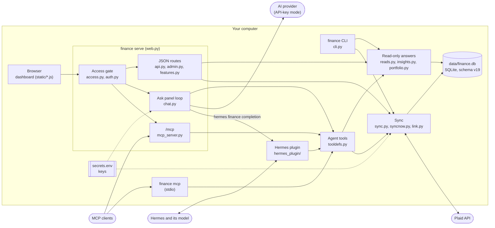

# Architecture

One Python package (`src/hermes_finance/`, standard library plus `argon2-cffi` and `ofxtools`), one SQLite file, and
three ways in: the browser, the `finance` CLI, and the agent adapters.

## How the pieces fit

- **`finance serve`** (`web.py`) is a stdlib `ThreadingHTTPServer` bound to loopback. Every request goes through the
  access gate first (Host, Origin, proxy identity or session, CSRF), then to a route module: `api.py` (dashboard
  payloads), `admin.py` (Settings, sign-in, backup, import, first-run setup), `features.py` (goals, splits, the bills
  calendar, rollover, Alpaca, tracked bills), `chat.py` (the Ask panel) and `/mcp`.
- **The page** is one HTML shell. `static/app.js` draws every page from the JSON API, with a few feature scripts
  beside it (`goals.js`, `bills.js`, `chat.js`, ...). Chart.js is vendored. The only third-party script is Plaid Link.
- **Numbers** come from pure functions over a database connection (`insights.py`, `portfolio.py`, `goals.py`,
  `bills.py`). The dashboard, the CLI read commands (`reads.py`) and the agent tools all call the same ones, which is
  why they agree. The numbers gate (`scripts/audit_numbers.py`) checks that they do.
- **The agent tools** are defined once (`tooldefs.py`) and wired into three adapters: the Hermes plugin
  (`hermes_plugin/`), the MCP server (`mcp_server.py`, stdio and HTTP), and the Ask panel (`chat.py`).
- **Sync** (`sync.py`) uses Plaid's `/transactions/sync` with a stored cursor, plus `/accounts/get`, and
  `/liabilities/get` and `/investments/holdings/get` where the bank has those products. Then it classifies
  (`classify.py`) and takes daily balance and holding snapshots. Net worth and portfolio history come only from those
  snapshots: nothing is back-filled.
- **Scheduled work** is not in the app. The plugin's jobs run `python -m hermes_finance.cronpipe daily|weekly`
  (`cronpipe.py`) through Hermes's scheduler.

## The database

`db.py` owns the schema. `SCHEMA_VERSION` is **19**, stored in `PRAGMA user_version`.

- `db.connect()` creates the data directory (0700) and the file (0600), turns on WAL, and runs `init_schema()` when the
  stored version is behind. `init_schema()` is idempotent: `CREATE TABLE IF NOT EXISTS`, guarded `ALTER TABLE ... ADD
  COLUMN` (`ADDED_COLUMNS`), one-time data steps gated on the version it started from, then the views are made again
  and the version is stamped. Every row is kept.
- `db.connect_readonly()` opens the file with `mode=ro`, sets `query_only`, and installs an authorizer that allows
  only reads and makes credential columns read as `NULL`. `finance query`, the read commands and the agent tools use
  it. They never upgrade a database. They refuse an older one.

Conventions every query relies on:

- **Signs follow Plaid**: `transactions.amount > 0` is money out (a purchase, a fee, a payment), `< 0` is money in (pay,
  a refund). This holds for every account type. In the views, `spend = amount`.
- **Classification precedence**: user > user rule > AI > AI rule > Plaid's category. A trigger protects user rows.
- **Views**: `v_transactions` (non-removed transactions with their effective category), `v_spend_lines` (a split
  purchase's lines in place of the transaction, which is what spending by category reads), and
  `v_monthly_category_spend`.
- **Item rows are never deleted.** They count toward the [10-connection limit](plaid.md#slots).

## Module map

| Module | Role |
|---|---|
| `cli.py` | The `finance` command line |
| `web.py` | `finance serve`: the page, the access gate and the routes |
| `access.py`, `auth.py` | The three access modes; the built-in login and MCP bearer tokens |
| `api.py`, `admin.py`, `features.py` | JSON routes: dashboard, Settings / setup / backup / import, features |
| `db.py` | Schema, migrations, read-write and read-only connections |
| `config.py`, `prefs.py`, `secretstore.py` | Paths and keys; typed settings; the secrets file |
| `plaid.py`, `link.py`, `sync.py`, `syncnow.py` | Plaid client; Link and the duplicate guard; sync; Sync now and refresh |
| `classify.py`, `rulebook.py`, `ai.py` | Rules and Plaid defaults; the rules manager; the AI queue and apply |
| `insights.py`, `portfolio.py`, `reads.py` | Budgets, recurring, cash flow, net worth; investments and debt; the read commands |
| `manual.py`, `importer.py`, `importfile.py` | Manual accounts and loan / card payment matching; CSV, OFX and QFX import |
| `bills.py`, `billcal.py`, `goals.py`, `rollover.py`, `txmeta.py`, `transit.py` | Tracked bills, the bills calendar, goals, budget rollover, splits / notes / tags, payments in transit |
| `valuation.py`, `photos.py`, `usage.py`, `cdp_client.py` | Car and home values; their pictures; the monthly call caps; the local Chrome client for Carfax |
| `logos.py`, `alpaca.py` | Bank and holding logos; the read-only Alpaca account |
| `tooldefs.py`, `mcp_server.py`, `mcp_state.py` | The agent tools; the MCP server; pending actions |
| `chat.py`, `bridge.py`, `aisession.py` | The Ask panel's loop; its bridge to Hermes; the session id OpenCode endpoints require |
| `cronpipe.py` | The plugin's daily and weekly pre-run steps |
| `redact.py`, `report.py`, `qr.py` | Secret scrubbing; status and plain-text tables; a stdlib QR code for the authenticator set-up |
| `backup.py`, `doctor.py` | Backup and restore of the database; `finance doctor` |
| `groupbudget.py`, `money.py` | Group budgets; dollar formatting for text |
